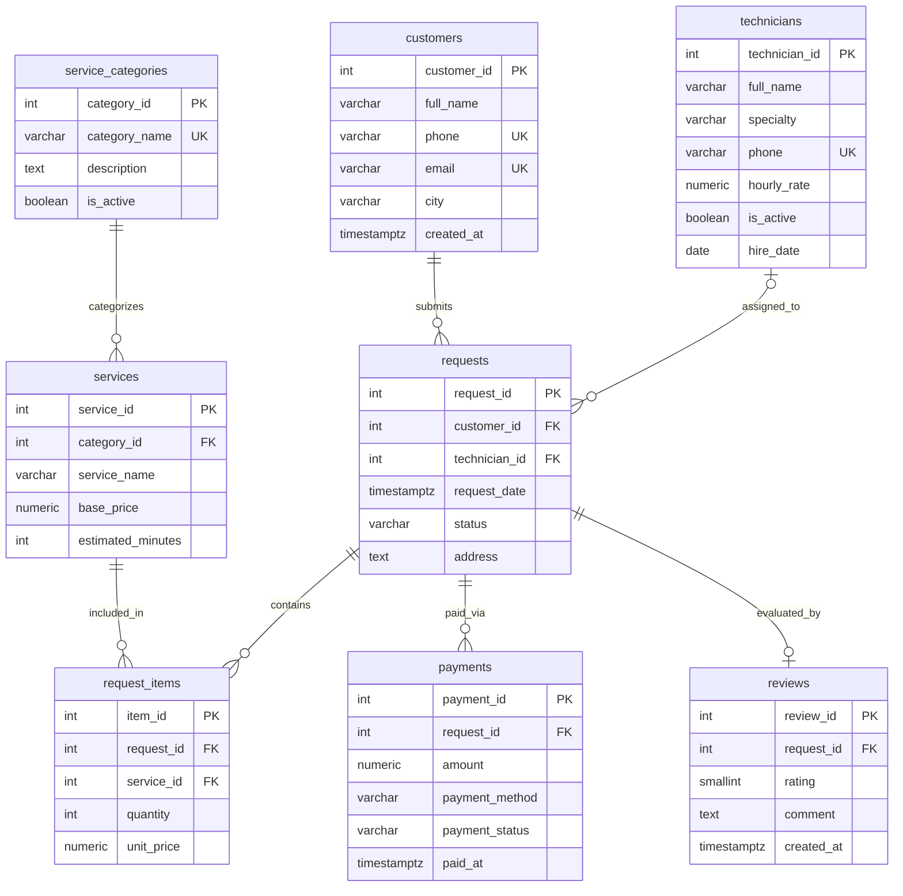

# Service & Repair Management Database

A relational database project built for **PostgreSQL 18** (`service_repair_db`) that models a technical service and repair management workflow—covering service categories, customers, certified technicians, service catalogs, customer repair requests, itemized billing lines, payment transactions, and customer reviews.

---

## Tech Stack

- **Database Engine:** PostgreSQL 18
- **Language:** Standard PostgreSQL SQL (DDL & DML)
- **Execution Tools:** `psql` CLI (with `-v ON_ERROR_STOP=1`) and `pgAdmin 4`

---

## Repository Structure

```text
service-repair-sql/
├── README.md                    # Project documentation and execution guide
└── sql/
    ├── 01_ddl_schema.sql        # Schema creation (8 tables, constraints, indexes, ALTER TABLE)
    ├── 02_seed_data.sql         # Transactional sample data insertion (6–13 rows per table)
    ├── 03_dml_queries.sql       # Analytical SELECT queries and safe UPDATE / DELETE demos
    └── 04_ddl_cleanup_demo.sql  # Standalone temporary table demo (CREATE, INSERT, SELECT, DROP)
```

<!-- Optional static diagram image once added:

-->

---

## Entity-Relationship Diagram (ERD)



---

## Database Schema Overview

All primary keys use `INTEGER GENERATED ALWAYS AS IDENTITY`, all monetary fields use `NUMERIC(10, 2)`, and all constraints and foreign-key indexes use explicit naming prefixes (`pk_`, `fk_`, `uq_`, `ck_`, `idx_`).

| # | Table Name | Group | Role & Description | Primary Key | Foreign Keys |
| :---: | :--- | :--- | :--- | :--- | :--- |
| 1 | `service_categories` | Supplementary | Groups repair services into logical categories | `category_id` | — |
| 2 | `customers` | Core | Stores customer contact details and cities | `customer_id` | — |
| 3 | `technicians` | Core | Stores technician specialties, hourly rates, status, and `hire_date` | `technician_id` | — |
| 4 | `services` | Core | Catalog of repair services with base price and duration | `service_id` | `category_id` → `service_categories` (`RESTRICT`) |
| 5 | `requests` | Core | Tracks service orders, status, address, and optional technician | `request_id` | `customer_id` → `customers` (`RESTRICT`), `technician_id` → `technicians` (`SET NULL`) |
| 6 | `request_items` | Supplementary | Line items per request with quantity and snapshot `unit_price` | `item_id` | `request_id` → `requests` (`CASCADE`), `service_id` → `services` (`RESTRICT`) |
| 7 | `payments` | Supplementary | Financial payment records (`PAID`, `FAILED`, `REFUNDED`) | `payment_id` | `request_id` → `requests` (`RESTRICT`) |
| 8 | `reviews` | Supplementary | One-to-one customer ratings (`1–5`) and comments per request | `review_id` | `request_id` → `requests` (`CASCADE`, `UNIQUE`) |

---

## Step-by-Step Execution Guide

### Option A: Using `psql` (Command Line)

1. **Create the target database:**
   ```bash
   psql -U postgres -c "CREATE DATABASE service_repair_db;"
   ```
   *(On Windows, if `psql` is not in `PATH`, use `"C:\Program Files\PostgreSQL\18\bin\psql.exe"`.)*

2. **Run the scripts in strict numerical order with `-v ON_ERROR_STOP=1`:**
   ```bash
   psql -U postgres -d service_repair_db -v ON_ERROR_STOP=1 -f sql/01_ddl_schema.sql
   psql -U postgres -d service_repair_db -v ON_ERROR_STOP=1 -f sql/02_seed_data.sql
   psql -U postgres -d service_repair_db -v ON_ERROR_STOP=1 -f sql/03_dml_queries.sql
   psql -U postgres -d service_repair_db -v ON_ERROR_STOP=1 -f sql/04_ddl_cleanup_demo.sql
   ```

### Option B: Using `pgAdmin 4`

1. Open **pgAdmin 4** and connect to your PostgreSQL 18 server.
2. Right-click **Databases** → **Create** → **Database...**, name it `service_repair_db`, and click **Save**.
3. Select `service_repair_db` and open **Query Tool**.
4. Open and execute the scripts one by one in order:
   1. `sql/01_ddl_schema.sql` — creates the 8 tables, constraints, indexes, and `hire_date` column via `ALTER TABLE`.
   2. `sql/02_seed_data.sql` — inserts sample data inside a transaction and prints row counts for all 8 tables.
   3. `sql/03_dml_queries.sql` — runs analytical `SELECT` reports first, followed by safe transactional `UPDATE` and `DELETE` examples.
   4. `sql/04_ddl_cleanup_demo.sql` — demonstrates creating, populating, querying, and dropping a standalone `temp_demo_log` table without altering core tables.

---

## Sample Analytical Queries

### 1. Completed Order Billing Details (`INNER JOIN`)

```sql
SELECT
    r.request_id,
    c.full_name AS customer_name,
    t.full_name AS technician_name,
    s.service_name,
    ri.quantity,
    (ri.quantity * ri.unit_price) AS line_total,
    p.amount AS total_paid_amount
FROM requests r
INNER JOIN customers c ON c.customer_id = r.customer_id
INNER JOIN technicians t ON t.technician_id = r.technician_id
INNER JOIN request_items ri ON ri.request_id = r.request_id
INNER JOIN services s ON s.service_id = ri.service_id
INNER JOIN payments p ON p.request_id = r.request_id
WHERE r.status = 'COMPLETED'
  AND p.payment_status = 'PAID'
ORDER BY r.request_id ASC, ri.item_id ASC;
```

### 2. Revenue per Service Category (`GROUP BY` + `SUM`)

```sql
SELECT
    sc.category_id,
    sc.category_name,
    COUNT(ri.item_id) AS completed_item_count,
    COALESCE(SUM(ri.quantity * ri.unit_price), 0.00) AS total_revenue
FROM service_categories sc
LEFT JOIN services s ON s.category_id = sc.category_id
LEFT JOIN request_items ri ON ri.service_id = s.service_id
LEFT JOIN requests r ON r.request_id = ri.request_id AND r.status = 'COMPLETED'
GROUP BY sc.category_id, sc.category_name
ORDER BY total_revenue DESC, sc.category_name ASC;
```

### 3. Top-Rated Technicians (`GROUP BY` + `HAVING`)

```sql
SELECT
    t.technician_id,
    t.full_name AS technician_name,
    COUNT(rv.review_id) AS review_count,
    ROUND(AVG(rv.rating), 2) AS avg_rating
FROM technicians t
INNER JOIN requests r ON r.technician_id = t.technician_id
INNER JOIN reviews rv ON rv.request_id = r.request_id
GROUP BY t.technician_id, t.full_name
HAVING AVG(rv.rating) > 4
ORDER BY avg_rating DESC, t.full_name ASC;
```
